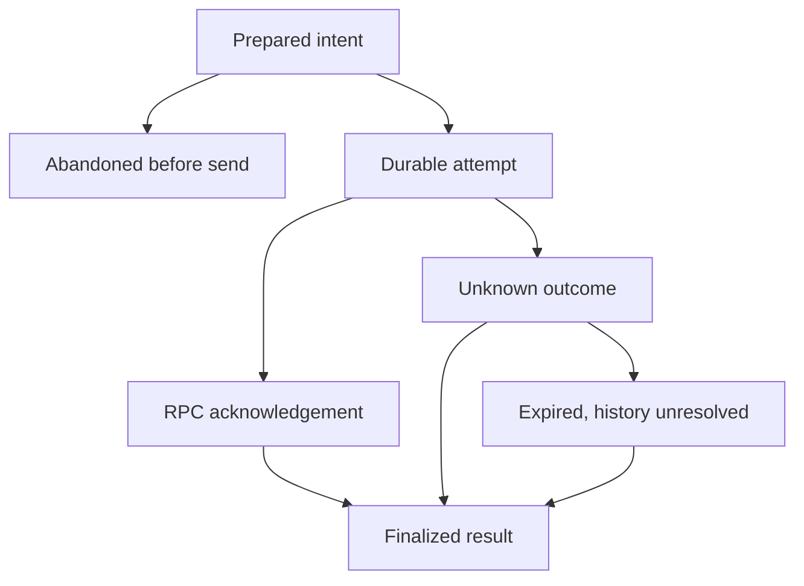

# Step 2: native devnet execution modules

The signing-only application remains the default. Explicit execution mode is native
funding only; it does not enable the full token lifecycle. Live testing is deferred.

| Module | Responsibility | Boundary |
| --- | --- | --- |
| `plans.js` | Recipient/amount policies and exact fee/reserve arithmetic | No signing, network or persistence |
| `transactions.js` | Compile, review, verify and issue single-use execution capabilities | No submission; cloned/serialized approvals cannot authorize execution |
| `network.js` | Fixed-endpoint validated read/simulation RPC | Generic `send()` remains refused |
| `execution-transport.js` | Fresh preflight and one exact-wire devnet submission | Only original permit + recent simulation proof + durable journal |
| `journal.js` | Append-only intents, decisions, acknowledgements, outcomes and payer leases | No secrets, signed payloads, deletion, automatic reset or network |
| `private-directory.js` | Trusted ancestry, owner-only roots and inode checks | Shared filesystem primitive for vault and journal |
| `executor.js` | Coordinate preparation, approval, send and original-signature recovery | Native funding only; no key management or re-signing |
| `wallet-server.js` | Authenticated local HTTP adapter | Fixed loopback, exact origin/Host, per-process session token |
| `web/` | Wallet connection, review, explicit simulation/send approval and recovery controls | No key material, direct chain submission or persistent browser storage |

## Submission sequence

1. Build a bounded funding plan and short-lived devnet review.
2. External wallet signs it; browser and server verify the exact bytes/signature.
3. Server retains the verified batch as an in-memory capability. Public JSON alone
   cannot be re-imported to create execution authority.
4. `/api/simulate` claims the batch, writes the public intent, acquires a payer lease,
   checks the blockhash, current fee, balance/reserve and signed-wire simulation.
5. User approves submission with that execution digest; `/api/submit` consumes the
   ticket and repeats preflight. Fees must still equal the reviewed fee.
6. The transport writes/fsyncs the exclusive `attempting` decision, consumes its
   permit, then posts exactly those bytes with preflight enabled, `maxRetries: 0`
   and the simulation slot as `minContextSlot`. There is no application retry loop.
7. The returned signature must equal the signature derived from the signed message.
   RPC acceptance is recorded as acknowledgement, never final success.
8. `/api/recover` checks the original signature with transaction-history searching.
   Only finalized status becomes a durable success/failure and releases the payer.

Simulation uses `sigVerify: true` and `replaceRecentBlockhash: false`; errors or an
RPC-provided replacement blockhash stop the flow. Simulation proofs expire after
five seconds, and original review/context expiry also remains binding. A new
signature/review is needed after expiry; the module does not rewrite blockhashes.

## Durable states

Prepared cancellation and submission compete to create the **same exclusive decision
file**. Exactly one can win, so another process cannot abandon an operation and then
have the old controller send it. An attempt marker is durable before any network
send. A crash after that marker but before the request is deliberately conservative:
recovery treats it as potentially sent. An RPC error/timeout cannot turn it back into
a prepared intent. The original signature remains the tracking key.

Payer claims use monotonically numbered exclusive files with immutable releases,
not deletable PID locks. Concurrent processes cannot each claim the same next lease;
a crash leaves a discoverable reservation. Unknown outcomes retain their reservation,
including expired blockhashes with absent history. This blocks new operations through
the same journal until the original result is established. It does not prevent the
wallet owner or another application from moving funds outside this application.
The reserve check is pre-send evidence, not an on-chain balance invariant.

Journal records contain public operation IDs, signature, fingerprints/digests,
payer, cluster/genesis, expiry and outcomes. Never remove the journal to retry.
Truncated/corrupt records fail closed and require manual inspection; there is no
automatic repair or pruning. The file-count quota is bounded. Duplicate protection
covers the same operation ID/journal; it cannot infer that an independently created
new plan is economically the same payment.

## Integration API

`POST /api/mode` reports whether the explicitly selected execution adapter is enabled.
Signing-only mode rejects all execution APIs.

| Endpoint | Input | Result |
| --- | --- | --- |
| `/api/verify` | Review digest and signed wire | Verification status; original capability remains server-side in execution mode |
| `/api/simulate` | Execution digest | Issued expiring ticket and refreshed budget |
| `/api/submit` | Execution digest | Accepted acknowledgement or uncertain outcome; one attempt |
| `/api/operations` | Empty object | Public saved operation IDs and durable states |
| `/api/recover` | Operation ID | Finalized/failed, pending, unknown, expired-unknown or abandoned-before-submission |

All routes require the same local origin/Host/session token controls. No route accepts
arbitrary unsigned transactions, replaces a blockhash, imports a key, changes network,
re-signs, retries a payment or force-releases unresolved state. Recovery is explicit
through the saved-operation controls; no background worker is required in this step.

## Extending the token lifecycle

Add creation, buying, selling and collection adapters behind separate action checks.
Each must supply verified account/mint/quote state, deterministic instructions and
reviewed cost/output policy. Do not simply broaden `claimVerifiedExecution` to accept
arbitrary routes. Multi-transaction/multi-payer and Jito execution need their own
batch settlement model; single-transaction funding finality is not bundle atomicity.
Mainnet is not accepted by any transport in this implementation.

## Validation status

Automated checks use disposable signatures, actual wire encoding and mocked RPC.
No real transaction was sent; no installed wallet extension or live devnet acceptance
test has been performed. The local browser visual smoke remains unverified.

Official RPC references consulted:
- https://solana.com/docs/rpc/http/simulatetransaction
- https://solana.com/docs/rpc/http/sendtransaction
- https://solana.com/developers/cookbook/transactions/confirmation
